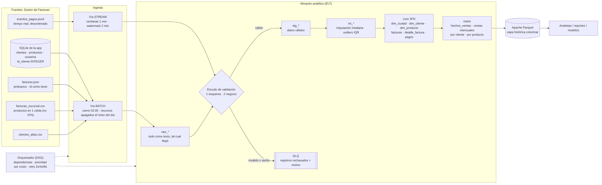

# Pipeline de Datos para el Gestor de Facturas

**Proyecto final de Ingeniería de Datos · Modalidad "Proyecto Puente" con Programación**
Versión 1.0.0

El **Gestor de Facturas** (app de escritorio en Python/PySide6, carpeta `app_gestor_facturas/`) es el
sistema de origen. Este repositorio construye detrás de él una **arquitectura de datos híbrida y resiliente**:
recibe facturas por lotes cada noche y pagos en tiempo real, separa los datos corruptos sin detenerse,
normaliza a 3FN, imputa faltantes y publica la historia limpia en Apache Parquet.



## Inicio rápido
```bash
python -m venv .venv
# Windows: .venv\Scripts\activate     Mac/Linux: source .venv/bin/activate
pip install -r requirements.txt

python -m pipeline.p0_generar_datos --reset     # 1. datos de origen con caos controlado
python orquestador.py --incluir-costosas         # 2. todo el pipeline + benchmark
python chaos_test.py                             # 3. la demo del Chaos Test
```

## Estructura
| Ruta | Qué es |
|---|---|
| `app_gestor_facturas/` | La app original de Programación (sistema de origen) |
| `puente_app/exportar_desde_app.py` | Convierte las facturas capturadas en la app en un lote del pipeline |
| `pipeline/p0_generar_datos.py` | Datos de origen con caos controlado |
| `pipeline/p1_ingesta_batch.py` | Vía batch, ELT, carga a `raw_*` |
| `pipeline/p2_ingesta_stream.py` | Vía stream con ventanas y watermark |
| `pipeline/p3_validacion.py` | Validación de esquema y negocio, DLQ, aplanado 1FN |
| `pipeline/p4_imputacion.py` | Outliers IQR, comparación media/mediana/KNN, imputación |
| `pipeline/p5_modelado.py` | Join roto, modelo 3FN y reportes |
| `pipeline/p6_parquet.py` | Exportación Parquet y benchmark contra CSV |
| `pipeline/p7_catalogo.py` | Catálogo de datos |
| `orquestador.py` | DAG con dependencias, prioridad por costo y Retry |
| `chaos_test.py` | Inyección de caos en vivo |
| `.github/workflows/pipeline_nocturno.yml` | Ejecución programada a las 02:00 |
| `docs/` | Modelo conceptual, arquitectura, linaje, catálogo, costos y reportes |
| `GUIA_PASO_A_PASO.md` | Guía para el equipo: cómo correrlo, qué explicar y guion del video |

## Mapa contra la rúbrica
| Requisito | Dónde |
|---|---|
| Modelo conceptual | `docs/01_modelo_conceptual.md` |
| Batch CSV + JSON con apagado de recursos | `p1_ingesta_batch.py`, workflow, `docs/05_costos_batch_vs_stream.md` |
| Stream con watermarking | `p2_ingesta_stream.py` |
| ETL vs ELT justificado | `docs/02_arquitectura.md` |
| Normalización 1FN-3FN | `p3_validacion.py` (1FN), `p5_modelado.py` (2FN/3FN) |
| Join roto | `utilidades.traducir_llave()`, `p5_modelado.demostrar_join_roto()` |
| Parquet + prueba comparativa | `p6_parquet.py`, `docs/reporte_benchmark.md` |
| Validación doble capa | `p3_validacion.py` |
| DLQ con ≥ 5 % de corruptos | tabla `dlq`, `data/dlq/dlq_completa.csv` (≈ 7 % del origen) |
| Imputación mediana vs KNN | `p4_imputacion.py`, `docs/reporte_imputacion.md` |
| Orquestador + Retry | `orquestador.py`, workflow |
| Linaje + análisis de impacto | `docs/03_linaje.md` |
| Catálogo referencia vs operativo | `docs/04_catalogo_datos.md` |
| Versionado semántico | `config.py`, `CHANGELOG.md`, tags de git |
