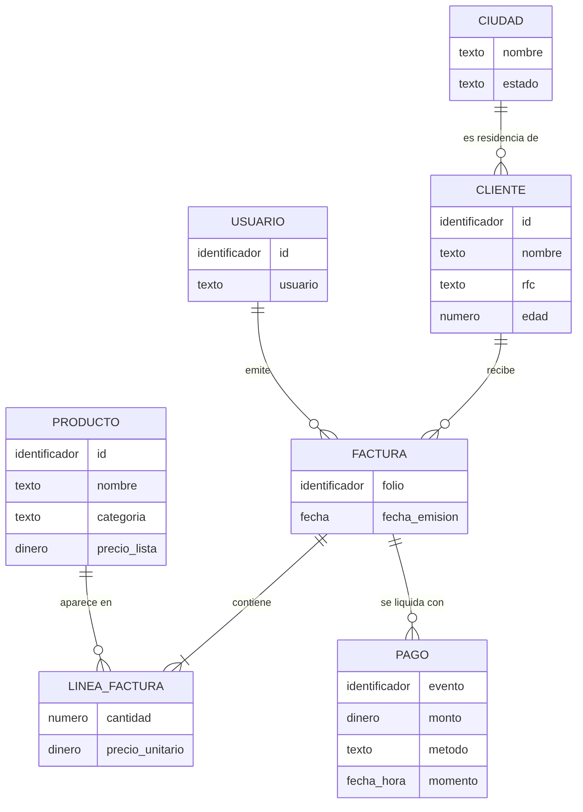

# 1. Modelo conceptual

El modelo conceptual describe **qué cosas existen en el negocio y cómo se relacionan**, sin hablar
todavía de tecnología (ni SQLite, ni Parquet, ni tipos de dato). Se hizo antes de programar.

## Entidades
| Entidad | Qué representa | Identificador |
|---|---|---|
| CLIENTE | Persona que recibe facturas. Debe ser mayor de edad y tener RFC válido. | id de cliente |
| CIUDAD | Lugar donde vive el cliente; cada ciudad pertenece a un estado. | nombre + estado |
| PRODUCTO | Bien o servicio que se vende, con una categoría y un precio de lista. | id de producto |
| USUARIO | Persona de la empresa que emite la factura desde la app. | id de usuario |
| FACTURA | Documento fiscal emitido a un cliente en una fecha. | folio |
| LINEA_FACTURA | Cada producto dentro de una factura, con cantidad y precio cobrado. | folio + número de línea |
| PAGO | Pago recibido en tiempo real que liquida una factura. | id de evento |

## Relaciones
- Un **cliente** recibe **cero o muchas** facturas; una factura es de **un solo** cliente.
- Una **factura** contiene **una o muchas** líneas (una factura sin productos no es válida).
- Un **producto** aparece en **cero o muchas** líneas.
- Un **usuario** emite **cero o muchas** facturas.
- Una **ciudad** es residencia de **cero o muchos** clientes.
- Una **factura** se liquida con **cero o muchos** pagos (pagos parciales).

## Reglas de negocio que salen del modelo
1. Cliente mayor de edad (18 a 110 años) y con RFC de formato válido.
2. Cantidad entera mayor que 0 y precio unitario positivo.
3. La fecha de la factura no puede ser futura respecto al cierre del día.
4. El folio es único: no puede registrarse dos veces.
5. Toda factura apunta a un cliente que existe y todas sus líneas a productos que existen.
6. Un pago tiene monto positivo y un método permitido (tarjeta, efectivo, transferencia).
7. El total de la factura **no se guarda**: se calcula como la suma de cantidad × precio de sus líneas.

## De dónde sale cada entidad
| Entidad | Proyecto de Programación (Gestor de Facturas) |
|---|---|
| FACTURA, LINEA_FACTURA, USUARIO | Ya existen en la app (`facturas`, `detalle_factura`, `usuarios`). |
| CLIENTE, PRODUCTO | En la app eran texto libre; aquí se vuelven catálogos con identificador. |
| CIUDAD | Nueva, para quitar la dependencia transitiva ciudad → estado. |
| PAGO | Nueva: la vía de tiempo real del pipeline. |
