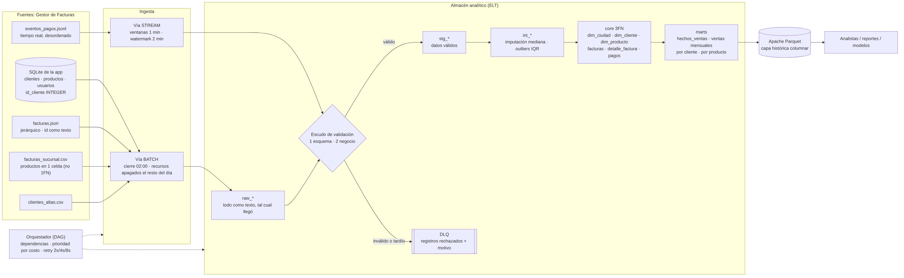

# 2. Arquitectura del pipeline

## Capas
| Capa | Tablas | Qué contiene |
|---|---|---|
| Origen | `data/fuente/gestor_facturas.db`, `data/entrada/` | Lo que produce la app: SQLite, JSON, CSV y eventos. |
| raw | `raw_*` | Copia exacta de lo que llegó, todo como texto. Nunca se modifica. |
| staging | `stg_*` | Solo registros que pasaron las dos capas de validación, ya con tipos correctos. |
| intermedia | `int_*` | Imputación (precios y edades) y marcas de outliers. |
| core 3FN | `dim_*`, `facturas`, `detalle_factura`, `pagos` | Modelo normalizado, con llaves y restricciones. |
| consumo | `hechos_ventas`, `mart_*`, `stream_cobranza_minuto` | Reportes finales listos para negocio. |
| histórica | `data/parquet/*.parquet` | Capa limpia en formato columnar para análisis rápido. |
| DLQ | `dlq` y `data/dlq/dlq_completa.csv` | Registros rechazados, con capa, motivo y dato original. |

## ¿ETL o ELT? → **ELT**
Primero se **cargan** los datos crudos al almacén (`raw_*`) y **después** se transforman ahí mismo.
Razones:
1. **Auditoría:** si una regla de negocio estaba mal, se puede volver a procesar desde `raw_*` sin pedirle
   los archivos otra vez a la app.
2. **Nada se pierde:** un registro corrupto llega al almacén y de ahí se manda a la DLQ con su original;
   en ETL se descartaría antes de llegar.
3. **El almacén hace el trabajo pesado:** los joins, la normalización 3FN y los reportes se calculan con
   SQL dentro del almacén (`p5_modelado.py`).
4. **Escala:** en la nube el mismo diseño se pasa a BigQuery, Snowflake o DuckDB, que están hechos para transformar dentro.

## Vía Batch
- Corre una vez al día a las **02:00** (cierre nocturno), programada en `.github/workflows/pipeline_nocturno.yml`.
- Lee cada carpeta `data/entrada/batch/AAAA-MM-DD/` que no se haya cargado (tabla `control_lotes`), así que
  volver a correrla no duplica nada (**idempotencia**).
- Recursos: el servidor existe solo mientras corre el proceso (ver `05_costos_batch_vs_stream.md`).

## Vía Stream (micro-batch) y watermarking
- Lee `eventos_pagos.jsonl` en el orden en que **llegan**, que no es el orden en que **ocurrieron**.
- Agrupa los pagos en **ventanas de 1 minuto** según la hora del evento (`event_time`).
- **Watermark = evento más reciente visto − 2 minutos.**
  - Un pago que llega 90 s tarde todavía entra a su ventana (*tardío aceptado*).
  - Un pago que llega 10 minutos tarde ya encuentra su ventana cerrada → **DLQ, capa `watermark`**.
- ¿Por qué 2 minutos? En los datos, el 96 % de los retrasos son menores a 100 s; esperar más haría que el
  reporte en tiempo real tardara en cerrarse, y esperar menos tiraría pagos legítimos.
- Recuerda hasta qué línea leyó (`control_stream`), así que solo procesa eventos nuevos.

## Escudo de validación (doble capa)
| Capa | Pregunta | Ejemplos de rechazo |
|---|---|---|
| formato | ¿se puede leer? | JSON truncado, celda `3:dos` sin el formato `id:cantidad:precio` |
| 1. esquema | ¿el tipo es correcto? | cantidad `"dos"`, precio `"abc"`, edad `"veinte"`, fecha `31/02/2026` |
| 2. negocio | ¿tiene sentido? | edad −5 o 15, cantidad −3, fecha futura, cliente inexistente, folio duplicado, RFC `XXXX` |
| watermark | ¿llegó a tiempo? | pago que llegó después de cerrar su ventana |

Una factura con **cualquier** línea inválida se rechaza completa: contablemente no se registra una factura a medias.

## Normalización (1FN → 3FN)
| Forma | Problema en el origen | Solución |
|---|---|---|
| 1FN | La sucursal manda `productos = "3:2:150.0|7:1:89.9"` (lista dentro de una celda) y el JSON trae `detalle` anidado. | Se separa en una fila por producto: `detalle_factura(folio, linea, ...)`. |
| 2FN | El CSV de sucursal trae `nombre_cliente` en cada renglón; depende solo del cliente, no de la factura. | Se elimina; el nombre vive en `dim_cliente`. |
| 3FN | `clientes(ciudad, estado)`: el estado depende de la ciudad, no del cliente (dependencia transitiva). | Nueva tabla `dim_ciudad(id_ciudad, ciudad, estado)`. |
| 3FN | La app guardaba `total` y `subtotal`, que se calculan de otras columnas. | No se guardan; se calculan en la vista `v_total_factura`. |

## Reto del Join roto
La app captura el id del cliente en un cuadro de texto (`QLineEdit`), así que lo exporta como **texto**:
`"100"`, `" 100 "`, `"100.0"`, `"0100"`. En la base relacional es **INTEGER** `100`.

| Intento | Resultado (corrida de referencia) |
|---|---|
| Unir texto contra entero directamente | **Error**: pandas no permite unir `object` con `int64` |
| Convertir el entero a texto | Solo 75 % de coincidencias; se pierden `" 100 "`, `"100.0"`, `"0100"` |
| `traducir_llave()` (quita espacios, interpreta `100.0` y `0100`, rechaza `"abc"` y `12.5`) | **100 %** de coincidencias |

## Orquestación
`orquestador.py` define el DAG (ver `python orquestador.py --ver-dag`):

| Tarea | Depende de | Costo |
|---|---|---|
| extraer_maestros | — | bajo |
| ingesta_batch | — | medio |
| ingesta_stream | — | bajo |
| validar_y_dlq | extraer_maestros, ingesta_batch | medio |
| imputar | validar_y_dlq | medio |
| modelar_3fn_marts | imputar, ingesta_stream | medio |
| exportar_parquet | modelar_3fn_marts | medio |
| catalogo_datos | modelar_3fn_marts | bajo |
| benchmark_parquet | exportar_parquet | alto (solo de noche o con `--incluir-costosas`) |

- **Prioridad por costo:** entre las tareas listas, primero corren las baratas; las de costo alto se dejan para la ventana nocturna.
- **Retry:** ante `ConnectionError`, `TimeoutError` o base bloqueada, reintenta hasta 3 veces esperando 2 s, 4 s y 8 s
  (backoff exponencial). Un error de lógica no se reintenta, porque repetirlo daría el mismo resultado.
- **Aislamiento de fallos:** si una tarea falla, solo se saltan las que dependen de ella.
