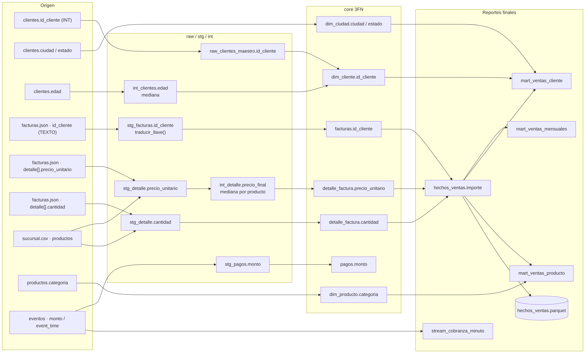

# 3. Data Lineage (linaje de datos)

El linaje muestra el camino de cada dato desde su origen hasta los reportes finales, a nivel tabla y columna.



## Linaje a nivel tabla
```
gestor_facturas.db.clientes  ─► raw_clientes_maestro ─┐
clientes_altas.csv           ─► raw_clientes_altas ─► stg_clientes_altas ─┴► int_clientes ─► dim_ciudad, dim_cliente ─┐
gestor_facturas.db.productos ─► raw_productos ─────────────────────────────────────────────► dim_producto ────────────┤
gestor_facturas.db.usuarios  ─► raw_usuarios (sin password) ───────────────────────────────► dim_usuario             │
facturas.json                ─► raw_facturas_json ─┐                                                                   │
facturas_sucursal.csv        ─► raw_facturas_csv ──┴► stg_facturas ─────────────────────────► facturas ────────────────┤
                                                   └► stg_detalle ─► int_detalle ───────────► detalle_factura ─────────┤
eventos_pagos.jsonl          ─► stg_pagos ─► pagos                                                                     │
                             └► stream_cobranza_minuto                                                                 │
                                                       hechos_ventas ◄────────────────────────────────────────────────┘
                                                       ├► mart_ventas_mensuales
                                                       ├► mart_ventas_cliente
                                                       ├► mart_ventas_producto
                                                       └► data/parquet/*.parquet
Cualquier registro rechazado en el camino ─► dlq ─► data/dlq/dlq_completa.csv, dlq.parquet
```

## Linaje a nivel columna (columnas clave)
| Columna final | Viene de | Transformación |
|---|---|---|
| `hechos_ventas.importe` | `detalle_factura.cantidad × precio_unitario` | cálculo |
| `detalle_factura.precio_unitario` | `facturas.json → detalle[].precio_unitario`, `sucursal.csv → productos` (3.er campo) | texto → decimal; nulo → mediana del producto |
| `detalle_factura.cantidad` | `detalle[].cantidad`, `productos` (2.º campo) | texto → entero; validación > 0 |
| `facturas.id_cliente` | `facturas.json → id_cliente` (texto) | `traducir_llave()` |
| `dim_cliente.edad` | `clientes.edad`, `clientes_altas.csv → edad` | texto → entero; 18..110; nulo → mediana |
| `dim_ciudad.estado` | `clientes.estado` | se separa de cliente (3FN) |
| `dim_producto.categoria` | `productos.categoria` | sin cambio |
| `hechos_ventas.anio / mes` | `facturas.fecha` | se extrae de la fecha |
| `stream_cobranza_minuto.monto_total` | `eventos.monto`, `eventos.event_time` | suma por ventana de 1 min, con watermark |

## Análisis de impacto
**Escenario: mañana la app renombra `precio_unitario` a `precio` en `facturas.json`.**

1. `p3_validacion` leerá el campo `precio_unitario` como vacío. Como el esquema lo permite nulo (se imputa),
   **no truena**: todas las líneas nuevas llegarán sin precio.
2. `p4_imputacion` rellenará el 100 % de esos precios con la mediana del producto.
3. Tablas afectadas: `stg_detalle` → `int_detalle` → `detalle_factura` → `hechos_ventas`.
4. Reportes afectados: `mart_ventas_mensuales`, `mart_ventas_cliente`, `mart_ventas_producto` y
   `hechos_ventas.parquet`. **No se rompen, pero quedan mal en silencio**: las ventas reales se cambian por medianas.
5. No se afectan: `dim_cliente`, `dim_ciudad`, `dim_producto`, `pagos`, `stream_cobranza_minuto`.

**Detección:** `mart_ventas_producto.lineas_con_precio_imputado` se dispararía de ~3 % a 100 %.
**Mitigación:** cambio MAJOR de esquema (2.0.0), alias `precio → precio_unitario` en `p3_validacion.py`
y una alerta si más del 10 % de un lote necesita imputación.

**Escenario 2: se elimina `id_cliente` de `facturas.json`.**
Todas las facturas del JSON fallarían la capa de esquema (`id_cliente: obligatorio y viene vacío`) y se irían
a la DLQ. Se dejarían de actualizar `facturas`, `detalle_factura`, `hechos_ventas`, los tres marts y el Parquet
para el canal de la app; el canal de sucursal (CSV) seguiría funcionando. Este cambio exige versión MAJOR.

**Escenario 3: se elimina `estado` de la tabla `clientes` de la app.** La tarea `extraer_maestros` falla de
inmediato (`no such column: estado`). No se reintenta, porque es un error de esquema y no un fallo temporal.
El orquestador salta `validar_y_dlq`, `imputar`, `modelar_3fn_marts`, `exportar_parquet` y `catalogo_datos`.
`ingesta_batch` e `ingesta_stream` sí terminan, así que los archivos del día quedan guardados en `raw_*` y se
procesan en cuanto se corrija la extracción. Mientras tanto, `dim_ciudad`, `dim_cliente`, los marts y el Parquet
conservan la versión de la corrida anterior.
