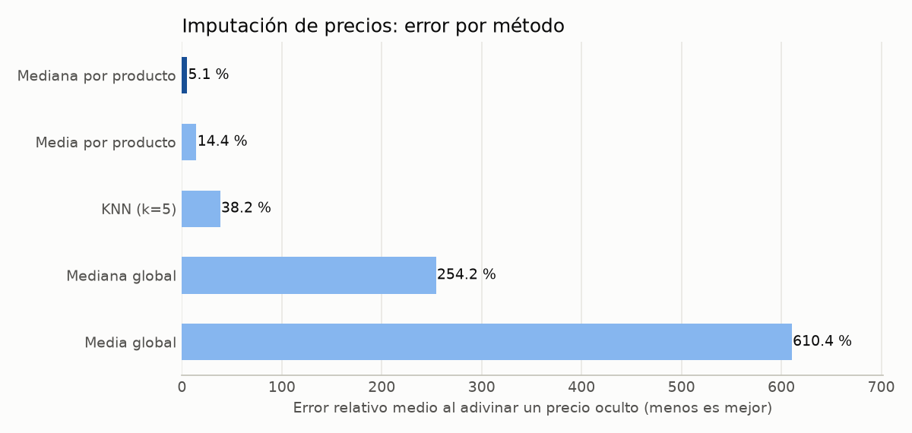

# Reporte de imputación (generado automáticamente por `p4_imputacion.py`)

## Qué se imputó
- Precios unitarios nulos imputados: **276**
- Edades de clientes nulas imputadas: **18**
- Precios marcados como outlier (IQR por producto, se conservan y se etiquetan): **134**

## Experimento: ¿qué método adivina mejor un precio?
Se ocultó al azar el 10 % de los precios conocidos y se estimaron con cada método.
Se midió el error contra el precio real en 845 casos (sin contar outliers).

| Método | Error absoluto medio | Error relativo medio |
|---|---|---|
| Mediana por producto ✅ | $111.46 | 5.1 % |
| Media por producto | $324.48 | 14.4 % |
| KNN (k=5) | $1,384.94 | 38.2 % |
| Mediana global | $1,667.34 | 254.2 % |
| Media global | $2,108.71 | 610.4 % |

**Método elegido: Mediana por producto.** Los métodos globales ignoran que una laptop y un cuaderno
cuestan cosas muy distintas, por eso fallan tanto. Entre los métodos por producto, la mediana
es más estable que la media porque los outliers (precios capturados con un cero de más) jalan
la media hacia arriba.

KNN obtuvo 38.2 % de error frente a 5.1 % de la mediana por producto:
KNN encuentra bien a los vecinos parecidos (mismo producto), pero después **promedia** su precio,
así que si uno de los 5 vecinos es un outlier x10, la estimación se infla. Es decir, KNN hereda
el mismo defecto de la media. Además es más caro de calcular. Por eso se elige la mediana por
producto: simple, rápida y robusta ante valores extremos.

## Evidencia: la media se deja arrastrar por los outliers
| Producto | Precio lista | Media | Mediana | Media vs mediana | Outliers |
|---|---|---|---|---|---|
| Archivero metálico | $3,900.00 | $4,872.17 | $3,924.78 | +24.1 % | 10 |
| Mantenimiento preventivo | $950.00 | $1,146.78 | $943.71 | +21.5 % | 7 |
| Laptop 14 pulgadas | $14,500.00 | $17,360.62 | $14,547.39 | +19.3 % | 8 |
| Licencia ofimática anual | $1,900.00 | $2,269.67 | $1,912.53 | +18.7 % | 8 |
| Paquete de hojas carta | $115.00 | $133.97 | $113.44 | +18.1 % | 7 |

La mediana se queda cerca del precio de lista; la media se infla en proporción a los outliers.
